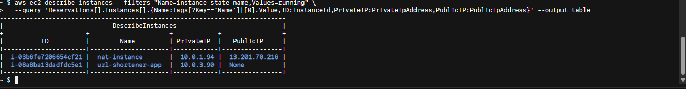
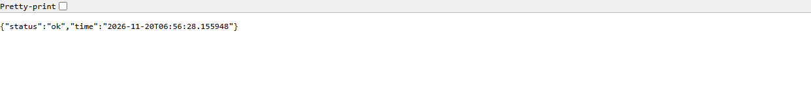
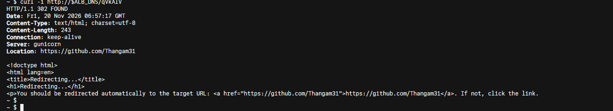

# URL Shortener: Stage 2 (3-Tier AWS Architecture)

Stage 2 of my DevOps portfolio. One URL shortener app, rebuilt in increasingly production-grade stages.

| Stage | What | Repo |
|---|---|---|
| 0 | Portfolio site (S3 + CloudFront + GitHub Actions) | portfolio-site |
| 1 | Single EC2, Docker, systemd, shell script | url-shortener-stage-1 |
| **2** | **3-tier: ALB + Auto Scaling + private subnets + NAT instance** | **this repo** |
| 3 | Everything in Terraform | url-shortener-terraform |

## Architecture

~~~
Internet
   |
   v
ALB (public subnets, ap-south-1a / 1b)
   |  port 80 -> target group (port 8080, health check /health)
   v
Auto Scaling Group (private app subnets, no public IP)
   |  Docker container: gunicorn + Flask
   v
NAT instance (public subnet) --> Internet (image pull, updates)
~~~

### Network layout

| Layer | Subnets | Public IP |
|---|---|---|
| Public | public-1a, public-1b (ALB, NAT instance) | Yes |
| App | app-1a, app-1b (ASG instances) | No |
| Data | data-1a, data-1b (reserved for DB, Stage 5) | No |

### Security groups

| SG | Inbound |
|---|---|
| alb-sg | 80 from 0.0.0.0/0 |
| app-sg | 8080 from alb-sg only, 22 from VPC CIDR |
| nat-sg | Traffic from private subnets, admin SSH |

### Design decisions

- **App tier in private subnets.** Only the ALB is internet-facing, which reduces the attack surface.
- **App SG allows port 8080 only from the ALB SG**, not from CIDR ranges.
- **NAT Instance instead of NAT Gateway.** A NAT Gateway costs about $32/month and has no free tier. A t3.micro NAT instance fits the free tier.
- **ELB health checks on the ASG** (not just EC2 status), so an unhealthy app gets replaced.
- **Two AZs** for the ALB and the ASG.

## Proof it works

Instances: the app server has no public IP, the NAT instance does.



Health check through the ALB:



Shorten and redirect:


~~~
POST /shorten  ->  {"code":"qVkAIV","short":"http://<alb-dns>/qVkAIV"}
GET  /qVkAIV   ->  302 FOUND, Location: https://github.com/Thangam31
~~~

## Troubleshooting

### Incident 1: ASG kept launching instances, none healthy

**Symptom:** ASG had Desired = 1, but more instances kept appearing and the target never became healthy.

**Investigation:**
1. Instance had no public IP. This was expected, since it is in a private subnet.
2. NAT instance checks: IP forwarding on, source/dest check disabled, both fine.
3. `sudo iptables -t nat -L -n -v` showed an **empty POSTROUTING chain**.

**Root cause:** No iptables MASQUERADE rule on the NAT instance. Private instances could not reach the internet, so user-data (`dnf install docker`, `docker pull`) hung. Health checks failed, and the ASG kept replacing instances.

**Fix:**
1. Found the real interface name: `ip -o route get 1.1.1.1` gave `ens5` (not `eth0`)
2. `sudo iptables -t nat -A POSTROUTING -o ens5 -j MASQUERADE`
3. Persisted it: `iptables-services` + `iptables-save > /etc/sysconfig/iptables`
4. Verified both private subnets route `0.0.0.0/0` to the NAT instance
5. Terminated extra NAT instances, reset the ASG, target went healthy

**Lesson:** A NAT instance needs three things: IP forwarding, source/dest check off, and a MASQUERADE rule. Missing any one breaks all private-subnet egress.

### Incident 2: ALB, target group and ASG were gone

After cleanup, `describe-auto-scaling-groups` returned null and `describe-load-balancers` returned nothing. ASG creation failed with "Provided Target Groups may not be valid".

**Fix:** Rebuilt target group, ALB, listener and ASG from the CLI.

**Lesson:** Manual CLI and console work is fragile and hard to reproduce. This is why Stage 3 moves everything to Terraform.

## Known limitations and next steps

- Links are stored **in memory**, so they are lost when the container or instance is replaced. Next: DynamoDB or RDS data tier.
- Single NAT instance is a single point of failure (cost tradeoff).
- No SSM Session Manager (no IAM instance profile on the launch template).
- HTTP only. Next: HTTPS via ACM.

## Cost control

Free-tier friendly. At the end of each session:

```bash
aws autoscaling update-auto-scaling-group --auto-scaling-group-name url-shortener-asg --min-size 0 --desired-capacity 0
aws ec2 stop-instances --instance-ids <nat-instance-id>
```

The ALB bills hourly, so I delete it when I am not working on the project.

## Stack

AWS (VPC, EC2, ALB, Auto Scaling, Launch Templates), Linux (iptables), Docker, Python (Flask, gunicorn), AWS CLI

